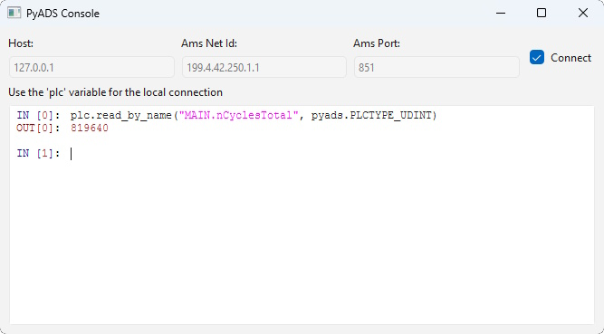

# Pyads Console

Super basic Qt application with an embedded console to interact with TwinCAT ADS.

This is made with [`pyads`](https://github.com/stlehmann/pyads), [`PySide6`](https://wiki.qt.io/Qt_for_Python) and [`qtconsole`](https://github.com/pyqtconsole/pyqtconsole).



## How to use

### How to install

Clone and then install with `uv` (preferred):
```
uv sync
```

Or with Pip directly:
```
pip install .
```

### How to run

Start the application through `uv` (which will automatically handle dependencies):
```
uv run pyads-console
```

Or start the application from Python with:
```
python -m pyads_console
```

Or use the executable directly:
```
pyads-console.exe
```
